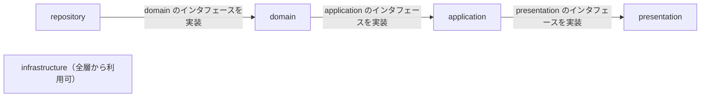

# AGENTS.md — daily-tasks（収集ツール）

AI コーディングエージェント向けの作業ガイド。
Cursor / Codex / Claude Code など複数ツールで共通利用する。

本ドキュメントは Java の収集ツール（バックエンド）のルールをまとめる。
プロジェクト全体の構成、Issue 解析の仕様、収集と公開の流れ、Java と TypeScript に共通するルールは
[kb002_daily-tasks_doc](https://github.com/KenichiroArai/kb002_daily-tasks_doc) にまとめているので、あわせて守る。

## プロジェクト概要

- **役割**: GitHub Issue（1 日 1 Issue）で管理している日々のタスクのうち、「持ち越し」（旧「繰り越し」「負債」）を Issue から収集・解析し、JSON として出力する
- **関連リポジトリ**（ローカルでは同じフォルダの下に兄弟ディレクトリとして置く）

| リポジトリ | 役割 |
| --- | --- |
| [daily-tasks-git](https://github.com/KenichiroArai/daily-tasks-git) | 基軸。Issue、ワークフロー、設定ファイル（`config/`）、出力データ（`docs/data/`） |
| gr002_daily-tasks（本リポジトリ） | 収集ツール（Java。Issue 取得 → 解析 → JSON 出力） |
| [mk002_daily-tasks_web-next](https://github.com/KenichiroArai/mk002_daily-tasks_web-next) | 画面（Next.js + TypeScript の静的エクスポート） |
| [kb002_daily-tasks_doc](https://github.com/KenichiroArai/kb002_daily-tasks_doc) | 設計書（収集ツールは `docs/design/backend.md`、画面は `docs/design/frontend.md`）と横断的なドキュメント |

- **GAV**: `kmg.gr.gr002` : `gr002_daily-tasks`
- **ルートパッケージ**: `kmg.gr.gr002.dailytasks`
- **対象リポジトリ**: `https://github.com/KenichiroArai/daily-tasks-git/`（Issue #1 から最新まで）
- **入出力**: 設定ファイル（`config/default-minutes.json`）と出力先（`docs/data/`）は daily-tasks-git にある。jar は daily-tasks-git をカレントディレクトリにして実行する

## 技術スタック

- 言語: Java 25（Temurin）
- フレームワーク: Spring Boot 4.x（`spring-boot-starter-parent`。DI・設定ファイルのバインド・メッセージ・ログ。Web サーバーは起動しない CLI アプリ）
- ビルド / パッケージ管理: Maven（spring-boot-maven-plugin で実行可能 jar を作成）
- ライブラリ: Jackson 3（JSON。パッケージは `tools.jackson.*`、アノテーションは `com.fasterxml.jackson.annotation`）、SLF4J + Logback（ログ）、kmg-fund 0.3.1（共通型。kmg-core 0.3.2 は kmg-fund が依存し、kmg-fund に無い型だけ直接使う）
- HTTP: 標準の `java.net.http.HttpClient`（GitHub REST API）
- テスト: JUnit 5 / JaCoCo（行・分岐 100%）/ ArchUnit（層間のルールの検査）
- 共通型は kmg-fund を優先し、kmg-fund に無いものだけ kmg-core から import する

## ディレクトリ構成

```text
pom.xml
.project / .classpath / .settings/  # Eclipse の設定（m2e の生成内容に合わせる）
launch/                      # Eclipse の実行の構成（収集の差分モード・全件モード、mvn clean package）
src/main/java/kmg/gr/gr002/dailytasks/
  DailyTasksApplication.java # 起動クラス（Spring Boot を起動するだけ）
  carryover/                 # 機能パッケージ（持ち越しの収集・集計）
    presentation/            # CLI などの入出力層
      command/               # コマンドのインタフェース（CommandLineRunner を継承）
      command/impl/          # コマンドの実装（run で引数の解析、設定の引き継ぎ）
      model/                 # 設定ファイルの値で application にもそのまま引き継ぐ設定（@ConfigurationProperties の CarryoverPropertiesModel）
      types/                 # 列挙型（コマンド引数 CommandOptionTypes、設定の文字列表現 CarryoverPropertiesFormatTypes）
      service/               # application に求めるサービス（CarryoverService。実装は application）
    application/             # ユースケースや業務ロジック層
      service/               # 役割ごとのサービス（CarryoverCollectService、CarryoverAggregateService。実装は impl）
      service/impl/          # presentation のサービスと役割ごとのサービスの実装（収集と集計）
      logic/                 # domain に求めるロジック（Issue の取得 DailyTaskIssueLogic、標準時間 DefaultMinutesLogic、解析結果と集計の読み書き CarryoverDataLogic、解析 CarryoverParseLogic、集計 CarryoverAggregateLogic。実装は domain）
      model/                 # 業務モデル（Issue、持ち越し項目、日別集計、標準時間、domain に引き継ぐ設定 CarryoverSourceModel）
      types/                 # 列挙型（残り時間の取得元 MinutesSourceTypes、Issue の状態 IssueStateTypes、取得元の文字列表現 CarryoverSourceFormatTypes。KmgCmnTypes を実装）
    domain/                  # 共通ロジック層
      logic/impl/            # application のロジックの実装（Issue の取得、標準時間の読み込み、解析結果と集計の読み書き、Issue 本文の解析ルール、日別の集計）
      repository/api/        # repository に求める外部 API（GitHubIssueApi。実装は repository/api）
      repository/dao/        # repository に求める DAO（JSON ファイル CarryoverDataDao、標準時間 DefaultMinutesDao。実装は repository/dao）
      dto/                   # repository と受け渡す DTO。変換先が変換元を受け取って作る（解析結果、集計、GitHub の Issue、接続設定 GitHubSettingsDto）
      types/                 # 列挙型（対象セクション TargetSectionTypes、解析の正規表現 CarryoverParsePatternTypes、解析の固定文字列 CarryoverParseTextTypes、接続設定の文字列表現 GitHubSettingsFormatTypes）
    infrastructure/          # 業務を知らない汎用ユーティリティ
      types/msg/             # メッセージの種類（Gr002GenMsgTypes、Gr002LogMsgTypes、Gr002ValMsgTypes）
      logic/                 # メッセージの取得のインタフェース（MessageLogic）
      logic/impl/            # メッセージの取得の実装（Spring の MessageSource を使う MessageLogicImpl）
    repository/              # データアクセス層
      api/github/            # 外部 API の実装（GitHub REST API からの Issue 取得 GitHubIssueApiImpl）
      dao/carryoverdata/     # DAO の実装（持ち越しの JSON ファイルの読み書き CarryoverDataDaoImpl）
      dao/defaultminutes/    # DAO の実装（標準時間の設定ファイルの読み込み DefaultMinutesDaoImpl）
      dto/json/              # JSON ファイルの形（Jackson のアノテーションを持つのはここだけ）
      logic/                 # domain の DTO と JSON の形の変換（CarryoverJsonConvertLogic）
      types/                 # 列挙型（出力ファイル名 CarryoverDataFileTypes、JSON の出力書式 CarryoverDataFormatTypes、GitHub API の URL GitHubApiUrlTypes、ヘッダ GitHubApiHeaderTypes、項目名 GitHubIssueFieldTypes、空文字 GitHubApiTextTypes）
src/main/resources/
  application.properties     # 設定値（carryover.*: 対象リポジトリ、トークン、出力先、標準時間のファイル、最新の件数。spring.*: Spring Boot の設定）
  messages.properties        # 一般メッセージ（使い方、例外）。キーは Gr002GenMsgTypes の key
  messages-log.properties    # ログメッセージ。キーは Gr002LogMsgTypes の key
  logback-spring.xml
src/test/java/kmg/gr/gr002/dailytasks/  # main と同じ構成
  testutil/                  # テスト用のユーティリティ（ログ取得、リフレクション、メッセージの取得の生成など）
src/test/resources/          # テスト用のリソース
```

収集ツールが読み書きするファイルは daily-tasks-git にある（jar は daily-tasks-git をカレントにして実行する）。

```text
daily-tasks-git/
  config/
    default-minutes.json     # 時間表記なしの行を補完する項目ごとの標準時間
  docs/data/
    issues/NNNN.json         # Issue ごとの解析結果（4 桁ゼロ埋め）
    summary.json             # 画面用の日別集計
```

## パッケージ構成のルール

- `kmg.gr.gr002.dailytasks` の直下に機能パッケージ（例: `carryover`）を置く
- 各機能パッケージは次の 5 層で構成する

| 層 | 役割 |
| --- | --- |
| `presentation/` | CLI などの入出力層（command など） |
| `application/` | ユースケースや業務ロジック層（service、logic、業務モデルなど） |
| `domain/` | 共通ロジック層（application のロジックの実装。データの取得・保存、解析、集計、変換など） |
| `infrastructure/` | 業務やドメインを知らない、他の層に依存しない汎用のユーティリティ（メッセージの取得など） |
| `repository/` | 外部 API（GitHub API など）とファイル・DB へのアクセス（DAO）のデータアクセス層 |

- 新しい機能は `carryover/` と同じ構成で追加する
- 各層の処理を受け持つクラスは、後述の「サービスとロジック」に従って `service/` か `logic/` にまとめる。データ系の型は後述の「データ系の型」に従って `model/`、`dto/`、`types/` にまとめる。データアクセスは後述の「外部 API と DAO」に従って `api/` か `dao/` にまとめる
- `command/` のように、フレームワーク（Spring など）に固有のものや、各層で使わない種類のものは、役割の分かるパッケージ名でそのまま置く
- 中身のないパッケージには、Git で消えないように Javadoc 付きの `package-info.java` を置く
- テストのパッケージは main と同じ構成にする

### データ系の型

| 種類 | パッケージ | 名前 | 置く層 | 内容 |
| --- | --- | --- | --- | --- |
| モデル | `model/` | `XxxModel` | repository 以外（presentation、application） | 層の中や層の間で受け渡すデータ。設定ファイルの値もモデルとする（例: `CarryoverPropertiesModel`、`CarryoverIssueModel`） |
| DTO | `dto/` | `XxxDto`（JSON の形は `XxxJsonDto`） | repository とやり取りするもの（domain の `dto/`）と repository の内部（repository の `dto/`） | repository との受け渡しやファイルの形のデータ（例: `CarryoverIssueDto`、`CarryoverIssueJsonDto`） |
| 列挙型 | `types/` | `XxxTypes` | 各層 | 値の種類を表す列挙型（例: `MinutesSourceTypes`）。`KmgCmnTypes<String>` を実装する |

- 名前の末尾は、置くパッケージに合わせて `Model`、`Dto`、`Types` とする

- domain の `dto/` は、domain が repository に求めるインタフェースの受け渡しの型として domain に置く（呼ぶ側の層が型を持つため）
- repository の `dto/` には、JSON のように決まった形のものをサブパッケージ（例: `dto/json/`）に分けて置く。決まった形でないものは `dto/` の直下に置く
- 列挙型は `model/` や `dto/` に混ぜず、その層の `types/` に置く
- 列挙型は kmg-core の `KmgTemplateTypes` を見本にする。コンストラクタの引数は `displayName`、`key`、`detail` の順で、この 3 つは必須とする。種類ごとの個別の値がある場合は、この 3 つの後ろに置く。フィールドも同じ順にする
- `NONE` は列挙型の必須定数であり、予約語とする。すべての列挙型の先頭に 1 つだけ置く。意味は常に「指定無し」で、`displayName` と `detail` は `"指定無し"`、`key` は `"None"` とする。メッセージの列挙型では、その後ろの文面も `"指定無し"` とする。別の意味の定数に `NONE` という名前を使わない
- `key` は列挙定数名を先頭大文字のラクダケースにしたものとする。例: `ISSUES_DIR` の `key` は `"IssuesDir"`。`NONE` の `key` は `"None"` とする
- `get`、`getKey`、`toString` が返すのは `key` だけである。呼び出し側でキーが必要なときは `getKey()` ではなく `get()` を使う。`KmgCmnTypes<T>` と `Supplier<T>` が扱う型 `T` は、この `key` の型である。`displayName` と `detail` は `String` のままとする
- `key` と実際に使う文字列が異なる場合は、`displayName`、`key`、`detail` の後ろに、その列挙型に合う名前の値を置く（例: `format`、`pattern`、`fileName`）。実際に使う文字列は、その値のゲッターで返す。`key` と同じ文字列は値に重複して持たない
- `getDefault`、`getEnum`（不明なキーは `NONE`）、`getInitValue`、`getDisplayName`、`getDetail` を持つ。kmg-fund に値の種類用の独自インタフェースはないので、kmg-core の `KmgCmnTypes<String>` を実装する
- 閉じた集合の文字列は、クラス内の文字列定数にせず、使う層の `XxxTypes` にする。対象はコマンド引数、対象セクション、出力ファイル名、残り時間の取得元、Issue の状態、正規表現、日付書式、`toString` の書式、JSON の項目名、GitHub API の URL・ヘッダ・空文字、項目名のフォールバック「不明」、JSON 出力のインデント・改行・ファイル名の書式である
- HTTP ステータスコード、タイムアウト、1 ページの件数のように文字列でない固定値は、それを使う実装クラスの定数にする

### 外部 API と DAO

repository 層のデータアクセスは、取得元によって次の 2 つに分ける。

| 種類 | インタフェース（domain） | 実装（repository） | 名前 | 内容 |
| --- | --- | --- | --- | --- |
| 外部 API | `domain/repository/api/` | `repository/api/<提供元>/` | `XxxApi` / `XxxApiImpl` | GitHub API などの外部のサービス（例: `repository/api/github/GitHubIssueApiImpl`） |
| DAO | `domain/repository/dao/` | `repository/dao/<用途>/` | `XxxDao` / `XxxDaoImpl` | ファイル（JSON など）や DB（例: `repository/dao/carryoverdata/CarryoverDataDaoImpl`） |

- `<提供元>` は API の提供元ごと（例: `github`）、`<用途>` はデータの用途ごと（例: `carryoverdata`、`defaultminutes`）のパッケージにする
- DB へのアクセスは今はないが、追加する場合もファイルと同じく DAO として `repository/dao/<用途>/` に置く
- 実装には `@Repository` を付ける

### サービスとロジック

| 種類 | パッケージ | 名前 | Bean | 内容 |
| --- | --- | --- | --- | --- |
| サービス | `service/` | `XxxService` / `XxxServiceImpl` | `@Service` | 一連の流れを行う |
| ロジック | `logic/` | `XxxLogic` / `XxxLogicImpl` | `@Component` | 個々の処理を行い、何度も呼ばれる |

- **サービス**: サービス・ロジック・ユーティリティ・モデルなどを使い、一連の流れを行う。初期化、主処理、サブ処理、終了処理のように、処理（メソッド）の流れがはっきりしている。役割が複数あるときは統合サービスを残し、役割ごとのサービスに分ける（例: `CarryoverServiceImpl#collect` は収集サービスの取得、解析、保存を順に呼び、`aggregate` は集計サービスの集計と保存を順に呼ぶ）。呼び出し元（コマンド）が呼ぶのは役割までとする
- **ロジック**: ロジック・ユーティリティ・モデルなどを使うが、サービスは呼ばない。メソッドごとに論理のまとまりになっており、各メソッドは基本的に互いに依存せず、サービス・ロジック・ユーティリティなどから何度も呼ばれる（例: get、read、write、exists、parse、aggregate、変換）。メソッド同士の依存は薄く、共通のパラメータだけをフィールドで共有する。インスタンス変数を共有する点がユーティリティとは異なる
- インタフェースと実装に分ける場合は、ほかの型と同じく、インタフェースを呼ぶ側の層の `logic/`、実装を呼ばれる側の層の `logic/impl/` に置く。自層の中だけで使う部品（変換など）は、インタフェースを作らずに `logic/` に具象クラスを置いてよい
- 名前に `Parser`、`Aggregator`、`Converter`、`Provider` などは使わず、`XxxLogic`（例: `CarryoverParseLogic`、`CarryoverAggregateLogic`、`MessageLogic`）とする
- ロジックは役割ごとに分ける。同じモデルや同じ設定を受け取ることではまとめない。基準は kb002_daily-tasks_doc の [docs/coding-rules.md](https://github.com/KenichiroArai/kb002_daily-tasks_doc/blob/main/docs/coding-rules.md) の「役割」に従う

## 層間のルール

依存性逆転の原則（DIP）に従う。目的は、各層（infrastructure を除く）を独立させ、下の層を別の実装に差し替えやすくすることである。例えば repository を JSON ファイルから DB に切り替えても、domain から上の層は変更しない。

処理の流れ（呼び出し）は上から下へ一本で追えるようにし、依存（import）はその逆向きにする。参照できる先を制限し、飛び越しをさせない。

処理の流れ:


依存の向き（import）:



### 参照の向き

- 依存（import）は処理の流れの逆向きに「すぐ上の層」だけにする。処理の流れと同じ向きの参照と飛び越しは禁止する
  - 許可: application → presentation、domain → application、repository → domain
  - 禁止の例: presentation → application、application → domain、domain → repository、repository → application、domain → presentation、エントリポイント → presentation
- infrastructure は全層から参照してよい。infrastructure から他の層は参照しない
- infrastructure には業務やドメインを知らない汎用のユーティリティだけを置く。機能固有の値（対象リポジトリ、出力先など）や業務の判断は置かない

### 公開するものと実装

- 呼ぶ側の層は、下の層に求めるインタフェースと受け渡しの型を、自層の種類ごとのパッケージに置く（モデルは `model/`、サービスは `service/`、ロジックは `logic/` など）
  - presentation: application に求めるサービス（`service/CarryoverService`）と設定（`model/CarryoverPropertiesModel`）
  - application: domain に求めるロジック（Issue の取得 `logic/DailyTaskIssueLogic`、標準時間 `logic/DefaultMinutesLogic`、解析結果と集計の読み書き `logic/CarryoverDataLogic`、解析 `logic/CarryoverParseLogic`、集計 `logic/CarryoverAggregateLogic`）と業務モデル（`model/`）
  - domain: repository に求める外部 API（`repository/api/GitHubIssueApi`）と DAO（`repository/dao/CarryoverDataDao`、`repository/dao/DefaultMinutesDao`）と DTO（`dto/`）
- 呼ばれる側の層は、すぐ上の層のインタフェースを `impl/` で実装する（例: `application/service/impl/CarryoverServiceImpl` は `presentation/service/CarryoverService` を実装する）
- 依存する側（下の層）が何を参照するかは制御しない。下の層は、すぐ上の層のどのクラス（`impl/` を含む）を参照してもよい。制限するのは層の向きと飛び越しだけとする
- 下の層を差し替えるときは、上の層のインタフェースを実装した別の `impl/` を用意する。上の層のコードは変更しない

### DI（依存性の注入）

- 実装クラスは Spring の Bean として登録し、生成と組み立ては Spring に任せる。自分で `new` して下の層の実装を生成しない
  - presentation のコマンド・各層のロジック（`logic/`、`logic/impl/`）: `@Component`
  - サービス（`service/impl/`）: `@Service`
  - repository の外部 API と DAO の実装: `@Repository`
- 注入はインスタンス変数への `@Autowired` で行う。コンストラクタでは依存を受け取らない
- 注入するインスタンス変数は `private` とし、`final` にはしない。Spring が生成後に代入するためである
- 受け取るのは「自層のインタフェース」（と自層の部品、infrastructure のインタフェース、`JsonMapper` などのフレームワークの部品）とする。実装は Spring が下の層から注入する
- Spring が注入しないインスタンス変数のうち、生成時に決まるもの（出力先や `HttpClient` など）は、コンストラクタで初期化する。テストからフィールドを差し替える。列挙型からの取得はフィールドの初期値にしてよい
- インスタンスの生存期間で共通な情報（複数メソッドで同じ値を使う値、そのオブジェクトが何に対する処理かを決める値）は、`initialize` で受け取りフィールドに保持する。コンストラクタでは受け取らない。依存の注入は `@Autowired` のままとする。`initialize` の戻り値は `void` とし、失敗は例外で表す
  - 共同作業者（ロジック、DAO、API、`MessageLogic`）は `@Autowired` のフィールドとし、`initialize` の引数にしない
  - メソッドごとに変わる入力（1 件の Issue、保存する解析結果、集計そのもの）はメソッドの引数のままにする
  - 1 メソッドの中だけで使う計算結果はローカル変数のままにする
- 状態を持つ Bean（`initialize` でフィールドを持つサービス、ロジック、外部 API、DAO）は `@Scope("prototype")` にする。シングルトンのままフィールドへ書くと、次の実行が前の設定を上書きする
- シングルトンが prototype を使うときは `ObjectProvider` で実行のたびに新しいインスタンスを取り、`initialize` してから処理する。prototype を prototype へ `@Autowired` する場合は、親が生成されるときに子も 1 つ作られるので、`ObjectProvider` にしない
- 呼び出し元が持っている情報は `initialize` で渡す。処理の途中で得て以降の呼び出しで共通になる情報は、その時点で下位の `initialize` に渡す
- コマンドは `CommandLineRunner` として Spring Boot の起動後に実行する。起動クラスは `SpringApplication.run` を呼ぶだけとする

### データの受け渡しと変換

- 境界で受け渡すデータ型は、呼ぶ側の層が持つもの（`model/`、`dto/`）を使う。変換は呼ぶ側の層で、自層の型に行ってから渡す。呼ばれる側の層は、受け取った型を必要に応じて自層の内部の型に変換する
  - presentation は設定ファイルの値（`presentation/model/CarryoverPropertiesModel`）とコマンドライン引数の値を application に渡し、application からは件数などの結果だけを受け取る
  - application は業務モデル（`application/model/`）を使って処理の流れを組み立てる。domain はこのモデルを使って解析・集計する
  - domain は application のモデルを自層の DTO（`domain/dto/`）に、変換先のコンストラクタで変換して repository とやり取りする。DTO からモデルへ戻すときは DTO のメソッドで行う
  - repository は domain の DTO を入出力に使い、JSON の形の型（`repository/dto/json/`）との変換を自層で行う（`repository/logic/CarryoverJsonConvertLogic`）
- JSON の形（Jackson のアノテーション）は `repository/dto/json/` だけが持つ。domain の DTO には付けない
- GitHub API の応答のように、JSON の形の型を作らずに読み取れるものは、外部 API の実装が domain の DTO を直接作ってよい

### 設定値の引き継ぎ

- 設定値も業務データと同じく、上の層から下の層へ引き継ぎ、境界ごとに呼ぶ側の層の型に変換して渡す。どこからでも参照できる共有の設定（infrastructure の設定クラスなど）は作らない。引き継ぎは `initialize` で行い、受け取った側はフィールドに保持する。メソッドごとの対象は引数で渡す
- 値の出どころは入力の窓口である presentation（コマンドライン引数・設定ファイル `src/main/resources/application.properties`）とする。設定ファイルは presentation だけが読み込む
  - 設定ファイルの `carryover.*` は `presentation/model/CarryoverPropertiesModel`（`@ConfigurationProperties`、コンストラクタでバインド）で受け取る。`@ConfigurationProperties` のクラスは presentation にだけ置く
  - 型の変換（文字列から `Path` など）は設定のクラスのコンストラクタで 1 回だけ行い、オリジナルの値と変換後の値をコメントで分けてフィールドに持つ。ゲッターは変換後の型で値を返すだけにする
  - トークンは `carryover.token=${GITHUB_TOKEN:}` として環境変数 `GITHUB_TOKEN` から設定する
  - `@Value` で設定値を個別に取得しない。`Environment` を各層から参照しない
  - presentation → application: `presentation/model/CarryoverPropertiesModel`
  - application → domain: サービスが `application/model/CarryoverSourceModel` を保持し、役割ごとのロジックへ必要な値（リポジトリとトークン、標準時間のファイル、出力先）だけを渡す
  - domain → repository: `domain/dto/GitHubSettingsDto`、ファイルのパス（`Path`）
- GitHub API のベース URL のような、業務の設定ではない技術的な固定文字列は、それを使う層の `XxxTypes` にする。HTTP ステータスコード、タイムアウト、1 ページの件数のように文字列でない固定値は、それを使う実装クラスの定数にする
- トークンは設定型の `toString` に含めない

### 文字列（メッセージ）の管理

- 使い方と例外の文面は `src/main/resources/messages.properties`、ログの文面は `src/main/resources/messages-log.properties` に置く。プロパティのキーは列挙型の `key` とする。コード付きのメッセージでは `key` を列挙定数名のパスカルケースにする。`NONE` の `key` は `"None"` とする
- メッセージの種類は `carryover/infrastructure/types/msg` に置く。全層から参照する
  - 一般（使い方、例外）: `Gr002GenMsgTypes` は `KmgFundCmnGenMsgTypes` と `KmgFundCmnExcMsgTypes` を実装する。コードは `GR002_GEN11xxx`
  - ログ: `Gr002LogMsgTypes` は `KmgFundCmnLogMsgTypes` を実装する。コードは `GR002_LOG12xxx`
  - バリデーション: `Gr002ValMsgTypes` は `KmgFundCmnValMsgTypes` と `KmgFundCmnExcMsgTypes` を実装する。コードは `GR002_VAL13xxx`。該当がなければ `NONE` だけ置く
- メッセージの列挙型も `displayName`、`key`、`detail` の順で受け、その後ろにメッセージの値（文面）を置く。`key` はプロパティのキーであり、`get` と `getCode` は `key` を返す。文面はプロパティと列挙型のメッセージの値の両方に書く
- 取得はインスタンス変数に注入した `infrastructure/logic/MessageLogic#get(KmgFundCmnMsgTypes)` を使う。実装は `get()` で Spring の `MessageSource` を引数なしで引くため、`{}` や `%s` はそのまま返る。kmg-fund の `KmgMessageSource`（`{0}` とログ先頭へのコード埋め込み）は使わない
- ログは SLF4J の `{}`、例外は `String.format` の `%s` / `%d` を埋め込み位置に使う。取得したメッセージはいったん変数に入れてから渡す
- 新しいメッセージは空き番号を採番し、同じ番号を再利用しない
- 解析ルールの正規表現は messages.properties に置かず、`CarryoverParsePatternTypes` に置く。日付書式や項目名のフォールバックは `CarryoverParseTextTypes` に置く。対象セクション名は `TargetSectionTypes` にする

### ルールの検査

- 層間のルール（依存はすぐ上の層だけ。飛び越しと処理の流れと同じ向きの参照の禁止）、コンストラクタによる依存の注入の禁止、`@Value` の禁止、`@ConfigurationProperties` を presentation にだけ置くこと、Jackson のアノテーションを `repository/dto/json/` にだけ置くこと、ロジック（`logic/`）がサービス（`service/`）を参照しないことは `ArchitectureTest`（ArchUnit）で検査する。違反があると `mvn test` は失敗する

## Issue 解析の仕様と収集のモード

- Issue 解析の仕様（対象セクション、時間表記、標準時間の補完、`declaredCount`、項目名の正規化）と、差分モード・全件モード、出力する JSON の形式は kb002_daily-tasks_doc の [docs/carryover-spec.md](https://github.com/KenichiroArai/kb002_daily-tasks_doc/blob/main/docs/carryover-spec.md) に記載する
- 収集から公開までの流れ（GitHub Actions）は kb002_daily-tasks_doc の [docs/overview.md](https://github.com/KenichiroArai/kb002_daily-tasks_doc/blob/main/docs/overview.md) と daily-tasks-git の AGENTS.md に記載する
- 解析ルールを変更した場合は、kb002_daily-tasks_doc の仕様もあわせて更新する
- GitHub API のトークンは環境変数 `GITHUB_TOKEN` から取得する

## ビルド・テスト

```bash
# テスト（JaCoCo 100% チェック）+ 実行可能 jar の作成（本リポジトリで実行）:
mvn clean package

# テストのみ:
mvn test

# 収集の実行（daily-tasks-git をカレントにして実行。差分モード / 全件モード）:
cd ../daily-tasks-git
java -jar ../gr002_daily-tasks/target/gr002_daily-tasks-0.1.0.jar
java -jar ../gr002_daily-tasks/target/gr002_daily-tasks-0.1.0.jar --full
```

- カバレッジレポート: `target/site/jacoco/index.html`
- 行 / 分岐カバレッジが 100% 未満だと `mvn test` は失敗する

## Eclipse

- 「ファイル」→「インポート」→「Maven」→「既存 Maven プロジェクト」でリポジトリのルート（`pom.xml`）を読み込む
- Java 25 に対応した Eclipse（2025-09 以降）を使い、JDK 25 をインストール済み JRE に登録して実行環境 `JavaSE-25` に割り当てる
- Eclipse の設定（`.project`、`.classpath`、`.settings/`）は Git で管理する。文字コード UTF-8、改行 LF、Java 25、`-parameters`（`pom.xml` の `<parameters>true</parameters>` と同じ。設定のコンストラクタバインドに必要）を設定している
- `.classpath` と `.settings/` は m2e が `pom.xml` から生成する内容に合わせる。`pom.xml` を変更したら「Maven」→「プロジェクトの更新」で反映し、差分が出たらあわせてコミットする
- `bin/` と `.factorypath` は Git で管理しない
- 実行の構成は `launch/` に置く（収集の差分モード・全件モード、`mvn clean package`）。収集の作業ディレクトリは `${project_loc:gr002_daily-tasks}/../daily-tasks-git`（daily-tasks-git のルート）にする
- 実行の構成に `GITHUB_TOKEN` などのシークレットを書かない（Eclipse を起動した環境から引き継ぐ）

## 作業時の原則

- Issue 本文のフォーマットの揺れに強い解析にする（想定外の行は落とさずに警告ログを出す）
- 既存の JSON の形式を変える場合は、全件モードで再生成できることを確認する
- 本ドキュメントのパッケージ構成ルール・コーディングルール・テストルール・Javadoc ルールに従う
- `target/` はビルド生成物であり、Git で管理しない

## Java のコーディングルール

### メソッドの戻り値

- メソッドの戻り値は変数 `result` で定義する
- メソッドの戻り値の変数は先頭で宣言する
- return 文は `return result;` に統一する
- このルールは画面（mk002_daily-tasks_web-next の TypeScript）にも共通する。共通ルールは kb002_daily-tasks_doc の [docs/coding-rules.md](https://github.com/KenichiroArai/kb002_daily-tasks_doc/blob/main/docs/coding-rules.md) を参照する

### 初期化

- 生成時に決まるインスタンス変数の初期化はコンストラクタで行う。ブレークポイントを置いてデバッグしやすくするためである。依存の注入はインスタンス変数の `@Autowired` のままとし、コンストラクタでは依存を受け取らない
- インスタンスの生存期間で共通な情報は `initialize` でフィールドに代入する。コンストラクタではこの情報を受け取らない
- ロガー（`LoggerFactory.getLogger`）はフィールドの初期値にしてよい
- 値が変動しないクラス変数（リテラル、`Duration.ofSeconds`、`Pattern.compile`、列挙型からの取得など）はフィールドの初期値にしてよい。クラス変数へインスタンスを入れるだけのもの（列挙型の `VALUES_MAP = new HashMap<>()` など）もフィールドの初期値にしてよい。ハッシュ値の算出のように計算結果を求めるものは static 初期化子で代入する

### 処理コメント

- 機能ごと、処理のまとまり単位に `/* コメント */` で記載する
- 通常コメントは `//` で記載する

### Javadoc

- 修飾子に限らず必須。対象は package-info、クラス、インタフェース、enum、フィールド（インスタンス変数・クラス変数）、enum 定数、メソッド、コンストラクタ
- 必須タグは次のとおり
  - クラス、インタフェース、enum、package-info: `@author`、`@since`、`@version`
  - フィールド、enum 定数、メソッド、コンストラクタ: `@since`
  - メソッドとコンストラクタは、シグネチャに応じて `@param`（引数ごと）、`@return`（void 以外）、`@throws`（throws 句があるとき）も必須
- `@since` は追加したときのバージョン、`@version` は型を更新したときのバージョンとする。Javadoc の追加だけでは `@version` を上げない
- タグの間は空行で区切る。メソッドとコンストラクタのタグ順は `@since`、`@param`、`@return`、`@throws`、`@see`
- `{@inheritDoc}` は使わない。オーバーライドやインタフェースの実装でも、メソッドの説明と必須タグをそのメソッドに書く。説明は、実装するインタフェースの Javadoc に合わせる
- 後述の「Javadoc のフォーマットルール」に従う

### アクセス修飾子

- 外部に公開しないもの、サブクラスも使わないもの（フィールド・メソッド・コンストラクタ・入れ子クラス）は `private` にする
- 修飾子なし（パッケージプライベート）は原則として禁止する。例外として、enum のコンストラクタは言語仕様で暗黙に private なので修飾子を付けない
- テストから呼び出すためだけにパッケージプライベートにしない。テストでは `testutil/ReflectionTestUtil`（標準のリフレクション）で private のメソッド・フィールドにアクセスする
- 例外: JUnit の `@TempDir` フィールドなど、フレームワークの制約で `private` にできないもの。インタフェースのメソッドは暗黙的に `public` なので修飾子を付けなくてよい

### record の禁止

- `record` は使用しない。DTO や値オブジェクトも通常の `class` で定義する
- 理由: アクセサ・コンストラクタ・`equals` / `hashCode` / `toString` が自動生成されソース上に行が存在しないため、ブレークポイントを設定できず、どこで参照されたかのトレースやデバッグができない
- 代わりに次の形で実装する
  - フィールドは `private`（変更不要なら `final`）で定義する
  - 値はコンストラクタ（またはセッター）で設定する
  - 値の取得は `getXxx()` 形式のゲッターを明示的に定義する（JSON 変換時もゲッターが呼ばれるため、ブレークポイントで参照箇所を追える）
  - `equals` / `hashCode` / `toString` が必要な場合は明示的に実装する

```java
// 望ましくない形式:
public record CarryoverItemModel(String name) {
}

// 望ましい形式:
public class CarryoverItemModel {

    private final String name;

    public CarryoverItemModel(final String name) {

        this.name = name;

    }

    public String getName() {

        final String result = this.name;
        return result;

    }

}
```

### 早期リターンパターン

- 早期リターン（ガード節）を使用し、不要なネストを避ける
- 条件が満たされない場合は早期に `return` する
- if-else の代わりにガード節を使い、インデントの深さを最小限に抑える

```java
// 望ましくない形式:
if (condition) {
    // 処理A
    // 処理B
}

// 望ましい形式:
if (!condition) {
    return result;
}
// 処理A
// 処理B
```

```java
public boolean someMethod(String input) {
    boolean result = false;  // 先頭で戻り値変数を宣言

    // 早期リターン（ガード節）
    if (input == null) {
        return result;
    }

    // メインの処理
    result = true;

    return result;  // 統一された形式で return
}
```

### 列挙型の分岐

- 分岐の材料が列挙型の定数だけなら、if の連続ではなく switch を使う
- switch は式にする。文にすると、列挙型の全定数を case にしてもコンパイラが到達不能な default を足し、分岐網羅が 100% にならない。式ではその default が `MatchException` になり、計測から除かれる。定数を足したときはコンパイルエラーになる
- 同じ処理になる定数は統合せず、1 つの case に並べる（例: `HELP` と `HELP_SHORT`）
- 列挙型の `isXxx()` と if でまとめるのは、switch の case では表せない判定のときだけとする

```java
this.help = switch (option) {

    case FULL -> {

        this.full = true;
        yield this.help;

    }

    case HELP, HELP_SHORT -> {

        yield true;

    }

    case NONE -> {

        throw new IllegalArgumentException(arg);

    }

};
```

## テストのコーディングルール

### テスト単位

- メソッド単位で行い、`private` / `protected` / デフォルト / `public` すべて対象とする
- private メソッド・private 変数へのアクセスは標準のリフレクション（`java.lang.reflect`）を使う。共通処理はテスト用のユーティリティクラスにまとめる

### テストクラスのアノテーション

```java
@SuppressWarnings({
    "nls", "static-method"
})
```

### テストメソッド名

- `testXxx_パターンYyy` の形式とする
- 「Xxx」の先頭は大文字で対象メソッド名を入れる
- 「パターン」は正常系 `normal`、準正常系 `semi`、異常系 `error` とする
- 「Yyy」の先頭は大文字でテスト項目を入れる
- 例: `testXxx_normalYyy` / `testXxx_semiYyy` / `testXxx_errorYyy`

### テストメソッドのアクセス修飾子

- `testXXX` メソッドのアクセス修飾子はすべて `public` にする

### テストメソッドの中身

- 対象メソッドごとに行い、1 つのテストメソッドに 1 つのテストを実装する
- 正常系・準正常系・異常系に分けて実装する
  - 正常系: 正常処理が完了するパターン（正常に return され、throw されない）
  - 準正常系: 処理が正しく完了しないパターン（引数不正などにより return または throw）
  - 異常系: 正常系・準正常系以外の想定外パターン（通信エラー・ファイル入出力エラーなどにより throw）
- GitHub API への実通信はテストで行わない（`HttpClient` をモック化するか、テスト用のレスポンスを使う）

### テストメソッドの Javadoc

- フォーマット: `対象メソッド名 メソッドのテスト - パターン:テスト内容`
- パターンには正常系・準正常系・異常系を入れる

```java
/**
 * targetMethod メソッドのテスト - 正常系:引数が1文字の場合
 *
 * @since 0.1.0
 */
```

### テストコードの実装順序

1. **期待値の定義** — `/* 期待値の定義 */`、`expected` で始まる変数
2. **準備** — `/* 準備 */`、`test` で始まる変数
3. **テスト対象の実行** — `/* テスト対象の実行 */`、`test` で始まる変数
4. **検証の準備** — `/* 検証の準備 */`、`actual` で始まる変数
5. **検証の実施** — `/* 検証の実施 */`
   - `Assertions.assertTrue` / `assertFalse` / `assertEquals` は `actualXXX` と説明を記載する
   - `Assertions.assertEquals` は `expectedXXX` と `actualXXX` と説明を記載する

### 検証方法の指定

- 1 行ずつ検証する
- `Assertions.assertTrue` / `assertFalse` は、`Assertions.assertEquals` で代行できる場合は代行する。ただし `condition` が `boolean` なら `assertTrue` / `assertFalse` を使用する
- 例外の検証は `Assertions.assertThrows` を使い、例外の型とメッセージを検証する
- `isInstance` / `instanceof` の比較は `Assertions.assertInstanceOf` を使用する
- null チェックは `Assertions.assertNull` を使用する
- それ以外は `Assertions.assertEquals` を使用し、期待値は「期待値の定義」の値を使う

### メッセージの検証

- ログメッセージは Logback の `ListAppender` で取得し、1 行ずつ検証する

```java
@Test
public void testMethod() {

    /* 期待値の定義 */
    final String[] expectedMsgs = {
            "メッセージ1",
            "メッセージ2",
            "メッセージ3",
    };
    /* 準備 */

    /* テスト対象の実行 */

    /* 検証の準備 */
    final String[] actualMsgs = this.listAppender.list.stream().map(ILoggingEvent::getFormattedMessage)
        .toArray(String[]::new);

    /* 検証の実施 */

    // ログのチェック
    final int verMsgLength = Math.min(expectedMsgs.length, actualMsgs.length);

    for (int i = 0; i < verMsgLength; i++) {

        Assertions.assertEquals(expectedMsgs[i], actualMsgs[i],
            String.format("メッセージが一致しません: %s", expectedMsgs[i]));

    }

    // ログの数のチェック
    Assertions.assertEquals(expectedMsgs.length, actualMsgs.length);

}
```

## Javadoc のフォーマットルール

### 基本形式

```java
/**
 * クラスの説明をここに書きます。
 * 複数行の説明の場合は、このように記述します。
 *
 * @author 作成者名
 *
 * @since 0.1.0
 *
 * @version 0.1.0
 */
public class SampleClass {

    /**
     * フィールドの説明をここに書きます。
     *
     * @since 0.1.0
     */
    private String field;

    /**
     * メソッドの説明をここに書きます。
     * 処理の詳細や目的を記述します。
     *
     * @since 0.1.0
     *
     * @param param1
     *                最初のパラメータの説明
     * @param param2
     *                2番目のパラメータの説明
     *
     * @return 戻り値の説明
     *
     * @throws Exception1
     *                    例外が発生する条件の説明
     * @throws Exception2
     *                    別の例外が発生する条件の説明
     *
     * @see 関連するクラスやメソッドへの参照
     */
    public String sampleMethod(String param1, int param2) throws Exception {
        // メソッドの実装
    }
}
```

### 主要なタグ

| タグ | 用途 |
| --- | --- |
| `@param` | メソッドのパラメータの説明 |
| `@return` | 戻り値の説明 |
| `@throws` | 発生する可能性のある例外の説明 |
| `@author` | 作成者 |
| `@version` | バージョン情報 |
| `@since` | 導入されたバージョン |
| `@see` | 関連する他のクラスやメソッドへの参照 |
| `@deprecated` | 非推奨であることを示す |
| `@link` | 他のクラスやメソッドへのリンク |
| `@code` | コードの例を示す |
| `@value` | 定数値を参照する |
| `@serial` | シリアライズに関する情報 |

### 記述ガイドライン

- 最初の文は要約文として簡潔に書く
- フィールド（インスタンス変数・クラス変数）と enum 定数の Javadoc は複数行にし、説明と `@since` を書く。`@version` は付けない
- `@since` にはそのメンバーを追加したバージョンを書く。型の `@version` は、その型の実装を更新したバージョンに上げる
- 完全な文章で、技術的に正確に記述する
- 必要な情報を漏れなく記載し、HTML タグを適切に使う

コード例:

```java
/**
 * サンプルコードの使用例：
 * <pre>
 * {@code
 *     String result = obj.sampleMethod("test", 123);
 * }
 * </pre>
 */
```

リンク:

```java
/**
 * 詳細は{@link OtherClass#otherMethod()}を参照してください。
 */
```

箇条書き:

```java
/**
 * このメソッドは以下の処理を行います：
 * <ul>
 * <li>データの検証</li>
 * <li>データの変換</li>
 * <li>結果の保存</li>
 * </ul>
 */
```

### チーム統一フォーマット例

クラス、インタフェース、enum、package-info:

```java
/**
 * [型の名前]の説明
 *
 * 詳細な説明（必要な場合）
 *
 * @author KenichiroArai
 *
 * @since 0.1.0
 *
 * @version 0.1.0
 */
```

フィールド、enum 定数:

```java
/**
 * [フィールドの説明]
 *
 * @since 0.1.0
 */
```

メソッド、コンストラクタ:

```java
/**
 * [メソッドの説明]
 *
 * 詳細な説明（必要な場合）
 *
 * @since 0.1.0
 *
 * @param [引数名]
 *                [引数の説明]
 *
 * @return [戻り値の説明]
 *
 * @throws [例外クラス名]
 *                        [例外の発生条件]
 *
 * @see [参照すべき他のクラスやメソッド]
 */
```

## 変更時のチェックリスト

- [ ] パッケージ構成ルール（機能パッケージ + 5 層）の順守
- [ ] サービス（一連の流れ。`service/`）とロジック（個々の処理。`logic/`、サービスを呼ばない）の区分の順守
- [ ] データ系の型（`model/`、`dto/`、`types/`）と、データアクセス（外部 API は `api/<提供元>/`、ファイル・DB は `dao/<用途>/`）の置き場所の順守。値の種類は `KmgCmnTypes`、メッセージは `KmgFundCmn*MsgTypes` を実装していること。列挙型は予約語の `NONE` を先頭に持つこと
- [ ] 層間のルール（依存性逆転：依存はすぐ上の層だけ、飛び越し・処理の流れと同じ向きの参照なし、データ・設定値は呼ぶ側の層で自層の型に変換）の順守（`ArchitectureTest` が通ること）
- [ ] 下の層を差し替える場合、上の層のインタフェースを実装した `impl/` を追加し、上の層のコードを変更していないこと
- [ ] DI のルール（Bean として登録、インスタンス変数への `@Autowired`、コンストラクタでは依存を受け取らない、共通の情報は `initialize` でフィールドに保持し状態を持つ Bean は prototype、メソッドごとの対象は引数）の順守
- [ ] JSON 形式の後方互換の確認（変更時は全件モードで再生成）
- [ ] テストの追加 / 更新（命名・実装順序・検証方法を含む）
- [ ] `mvn test` で JaCoCo カバレッジ 100% を維持
- [ ] コーディングルール（戻り値 `result`、早期リターン、処理コメント、`record` 禁止、生成時の初期化はコンストラクタまたは static 初期化子、共通の情報は `initialize`）の順守
- [ ] アクセス修飾子の順守（公開しないものは `private`、修飾子なしは原則禁止）
- [ ] Javadoc の追加 / 更新（`{@inheritDoc}` は使わない）
- [ ] 解析ルールを変更した場合、`declaredCount` との食い違いと補完件数のログを確認し、kb002_daily-tasks_doc の仕様を更新
- [ ] JSON の形式を変えた場合、mk002_daily-tasks_web-next の画面（zod スキーマ）と kb002_daily-tasks_doc の設計書への影響を確認
- [ ] README の更新

## やってはいけないこと

- 機能パッケージの外（`kmg.gr.gr002.dailytasks` 直下など。起動クラスを除く）に業務クラスを置くこと
- 層を飛び越して参照すること（例: repository → application、domain → presentation、エントリポイント → presentation）
- 処理の流れと同じ向き（上の層から下の層）に参照すること（例: presentation → application、application → domain、domain → repository）
- 呼ぶ側の層のインタフェースや受け渡しの型に、呼ばれる側の層の都合（JSON の形の Jackson のアノテーションなど）を持ち込むこと
- コンストラクタで依存を受け取ること、`@Value` での設定値の個別取得、インスタンスの文脈をメソッド引数で渡し続けること、状態を持つ Bean をシングルトンのままにすること
- infrastructure に機能固有の値や業務の判断を置くこと、infrastructure から他の層を参照すること
- kmg-fund にある型を使わずに、同じ役割の型を kmg-core から import すること。kmg-fund に無い型を kmg-core から import することは許す
- 列挙型から `NONE` を省くこと、`NONE` を「指定無し」以外の意味で使うこと
- シークレット（`GITHUB_TOKEN` など）をコード・ログ・JSON に出すこと
- テストで GitHub API に実通信すること
- daily-tasks-git の `docs/data/` の JSON を手で編集すること（必ず収集ツールで生成する）
- 本リポジトリに画面のソースコードや出力データを置くこと（画面は mk002_daily-tasks_web-next、データは daily-tasks-git に置く）
- `record` を使うこと（ブレークポイントを設定できずデバッグ・トレースの妨げになるため。通常の `class` とゲッターで実装する）
- Javadoc に `{@inheritDoc}` を使うこと。オーバーライドしたメソッドにも説明と必須タグを書く
- 外部に公開しないメンバーを修飾子なし（パッケージプライベート）にすること（テストのためだけに公開範囲を広げない）
- 深いネストのままガード節を使わずに実装すること
- テストメソッドに複数ケースを詰め込むこと

## 参考リンク

- README: `./README.md`
- 基軸リポジトリ: `https://github.com/KenichiroArai/daily-tasks-git`
- 画面: `https://github.com/KenichiroArai/mk002_daily-tasks_web-next`
- 設計書・横断ドキュメント: `https://github.com/KenichiroArai/kb002_daily-tasks_doc`
- GitHub REST API（Issues）: `https://docs.github.com/rest/issues/issues`

## 順守

以上の内容を順守し、タスクを遂行してください。
